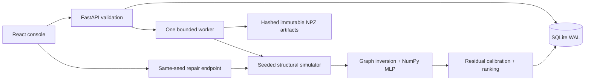

# Architecture

Faultline v0.1.0 is a single-process local research application. Python serves the compiled React frontend and JSON API. SQLite and NPZ files are the durable state; there is no hosted inference service.

## Components and contracts

| Module | Responsibility |
|---|---|
| `backend/faultline/schemas.py` | Input bounds, service IDs, scenario and mutation contracts |
| `topology.py`, `simulator.py` | Fixed DAG, seeded workload/noise, fault propagation and structural inversion |
| `ml/network.py` | Forward pass, analytic MSE gradients, seeded minibatches and Adam |
| `ml/features.py`, `ml/detector.py` | Sequence features, training-only scalers, support checks, empirical calibration, NPZ |
| `analysis.py`, `benchmark.py` | Label-free diagnosis; separately labeled held-out evaluation and paired repair |
| `store.py`, `engine.py` | SQLite transactions, idempotency, capacity, job execution and artifact publication |
| `api.py` | REST routes, error responses, exports and static assets |
| `frontend/src/App.tsx` | Selection, cancellation, job polling and completion refresh |
| `frontend/src/views/` | Investigation, experiment archive and model lab |

Telemetry has shape `[steps, 8, 3]` for latency, CPU and additive error signal, with a separate `[steps, 8]` request-rate array. All samples must be finite and aligned. API scenarios have 120–600 steps; the current UI uses 240. One simulation step represents one second, not a wall-clock delay.

## Data and failure semantics

The default directory is project-local `data/`. `faultline.db` stores jobs, models and runs. Each model has a server-generated ID, artifact filename, SHA-256 and training metadata. Runs retain the chosen model ID, exact scenario, analysis and simulator reference. New training changes the default for future runs; it never rewrites historical results.

1. Submission canonicalizes the original request and hashes it with the job kind. An optional nonempty `Idempotency-Key` identifies a request across retries. The execution payload separately freezes the resolved model ID. A default-model change does not change a retry's identity.
2. `BEGIN IMMEDIATE` serializes duplicate admission and the eight-active-job cap. The same key/input returns the original job; a changed input conflicts. This guarantee is for the application's single-process execution model.
3. A one-thread executor advances queued → running → completed/failed. Progress is persisted. Models are written to a temporary file and atomically renamed before registration.
4. Model or run insertion and terminal job publication occur in one database transaction. The UI cannot observe a completed job whose corresponding database result has not been published.
5. An orderly training exception cleans up the artifact it was creating. A hard crash after rename but before database commit can leave an unregistered file; it cannot expose a partial registered model. The release does not promise filesystem/database distributed transactions or automatic orphan-file garbage collection.
6. On startup, queued/running jobs are marked failed with an interruption explanation. Jobs are not transparently resumed. Retrying an old idempotency key returns that failed job; submit a new key to run again.

SQLite uses WAL, a ten-second busy timeout, short connections and parameterized SQL. Listed jobs/runs are capped at the latest 100; stored history is not deleted. This is an archive browser, not full-history pagination. Model integrity is verified before loading; NPZ is opened with `allow_pickle=False`.

## HTTP surface

Interactive schemas live at `/docs`; OpenAPI is `/openapi.json`.

| Method and path | Result |
|---|---|
| GET `/api/health`, `/api/topology`, `/api/presets` | Readiness summary, graph and scenario presets |
| GET/POST `/api/runs` | Recent runs / submit validated scenario and optional model ID |
| GET `/api/runs/{id}` | Complete stored run |
| GET `/api/runs/{id}/report`, `/export` | Markdown / JSON attachment |
| POST `/api/runs/{id}/replay` | Synchronous deterministic repair comparison |
| GET `/api/jobs`, `/api/jobs/{id}` | Recent jobs / persisted lifecycle |
| GET `/api/models`, `/api/models/{id}` | Immutable model records and provenance |
| POST `/api/models/train` | Asynchronous local training job |
| POST `/api/benchmarks` | Asynchronous held-out comparison |

Job submissions return HTTP 202. Missing resources return 404; changed idempotent requests 409; invalid input 422; full admission 503 with `Retry-After: 3`. Safe failure messages reach the UI, and detailed exceptions go to server logs. Queue capacity covers training, run and benchmark jobs; synchronous repair requests are not queued.

The default bind is loopback. Static assets come from `frontend/dist` or `FAULTLINE_FRONTEND_DIR`; missing API/asset paths do not silently return the SPA. The container explicitly sets both frontend and data paths for an installed Python package layout.

## Browser consistency

Changing runs clears the previous detailed run while fetching. Abort controllers cancel stale detail and repair requests; changing repair parameters invalidates the displayed comparison. The polling completion helper awaits list refresh before releasing terminal state. Dialog focus is restored on close, and all graph nodes and controls have accessible labels. The interface exposes synthetic-data boundaries beside evidence and intervention controls.

## Intentional limits

One Uvicorn process is required: multiple workers would each perform startup recovery and own independent queues. SQLite durability does not make this a distributed execution system. No authentication, tenancy, CSRF protection for an internet-facing deployment, telemetry ingestion, TLS termination, or public rate limiting is included. Add those in a separately designed integration phase before changing the deployment boundary.
