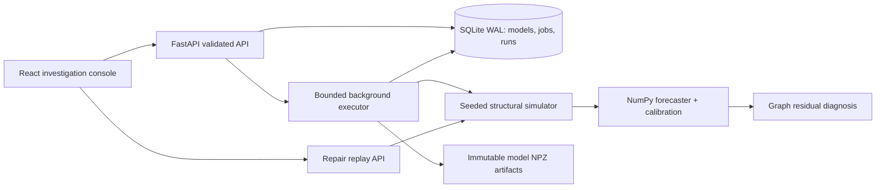

# Faultline: design and product brief

Status: selected by the builder under the user's explicit delegation of project choice and implementation. Date: 2026-10-29.

## Intent

Build a resume project that demonstrates software engineering and actual machine learning: an interactive incident investigation laboratory for a distributed commerce system. Inject a service fault, inspect its propagation, diagnose likely origins, and replay an intervention against exactly the same exogenous workload. Train the detector locally with no hosted AI API.

The user delegated product, language, and infrastructure choices, requested a detailed plan and a recoverable implementation, and asked that external integrations come last. Their actual profile is https://github.com/abdulksyed10 (provided during implementation); the connected GitHub account is a different person and must not be used as their baseline. Their public projects include a full-stack Formula 1 prediction app, ML notebooks, crawler/search assignments and scheduling applications. This project adds numerical ML integrated with a durable experiment product and systems reasoning. It does not promise a particular hiring outcome or claim a full audit of every prior codebase.

## Approaches considered

1. **Personalized recommendation platform:** real ranking/evaluation work, but cold-start data and a convincing demo require more curation.
2. **Document intelligence platform:** useful, but overlaps with the user's existing document/agent project area and risks concentrating the ML in third-party models.
3. **Incident investigation and replay lab (selected):** has measurable ground truth, an understandable visual demo, an independently implemented model, and meaningful storage/concurrency/API contracts. The tradeoff is simulator-to-reality validity. Make that limitation explicit everywhere results are interpreted.

## Definition of a complete local release

- Start with documented commands on Windows or Linux, or build the supplied container.
- On first startup train a default model and create one reproducible demonstration incident.
- Explore an eight-service dependency graph and synchronized latency, error, CPU, and anomaly timelines.
- Create custom experiments with a fault service, type, onset, duration, severity, traffic, and seed.
- Store runs durably in SQLite; async jobs expose queued/running/completed/failed states. Bound admission. Mark unfinished jobs interrupted after restart.
- Inspect a ranked diagnosis, onset, local model residual evidence, and downstream effects. Separate diagnosis inputs from injected truth.
- Replay a repair at a chosen service and time with identical random inputs. A repair removes the injected fault at that service; selecting an unaffected service must not fix the incident. Show observed versus replayed trajectories and explicitly label this as a simulator intervention.
- Train new immutable models, view learning curves and provenance, and evaluate held-out scenarios against an EWMA baseline.
- Export complete experiment JSON and a readable Markdown investigation report.
- Include mathematical notes, model/data cards, API docs, tests, CI, container support, a demo script, resume guidance, and a checkpoint for restarting work.

## Architecture

Single-repository application: Python 3.11+ / FastAPI / NumPy / SQLite backend and React / TypeScript / Vite frontend. Python serves built frontend assets in production, so deployment needs one process and one persistent volume. During development Vite proxies `/api` to Python. Use a small Python standard-library executor rather than introduce Redis, Kafka, Kubernetes, or managed services without a demonstrated need. One worker per process and one application process are deliberate local-release constraints.

## Simulation contract

Eight fixed services: gateway, checkout, catalog, payments, inventory, orders, cache, database. An edge caller -> dependency means requests flow forward and response latency/error effects propagate backward. The DAG is evaluated dependencies first. Each service has intrinsic latency, CPU utilization, and an intrinsic error probability, driven by request load, smooth seasonality, and independent noise. Observed latency and error signal include weighted dependency contributions. These are a structural synthetic model, not real networked microservices or packet-level emulation.

Pre-generate exogenous randomness with a seed before applying faults, so a repair never shifts the random sequence. Support latency, saturation, and error-burst faults. Saturation raises intrinsic latency and CPU; an error burst raises intrinsic errors; latency raises intrinsic latency. Bounds: 120..600 one-second steps, seed 0..2^31-1, traffic multiplier 0.5..2, severity 0.2..3, onset >= 20, duration >= 5, end <= steps. Replay time must lie inside the run. Healthy scenarios have no fault.

## ML contract

The **graph residual forecaster** first subtracts the simulator's known weighted dependency contributions from observed latency/error signal to estimate intrinsic service metrics. This structural inversion is an explicit modeling assumption. It is not learned causal discovery.

Construct features from four previous intrinsic metric vectors, present request rate, phase sin/cos, and service identity. Train a shared one-hidden-layer tanh MLP with manual analytic gradients, mean squared error, minibatches, seeded initialization/shuffle, and manually implemented Adam. Fit standardization on training sequences only. Use independent healthy seeds for training, calibration, and testing; never randomly split overlapping windows across these groups.

Fit empirical per-service calibration thresholds on maximum standardized positive residual across the three metrics. Report scores and empirical tail probabilities as descriptive evidence, not posterior root-cause probabilities or guaranteed time-series coverage. Keep residual scales bounded away from zero. Validate finite values and sufficient history; use `allow_pickle=False` for NPZ reads. Persist parameter count, hyperparameters, seeds, training curves, data fingerprint, threshold method, and artifact hash.

Diagnosis consumes only telemetry and the graph, never the injected service/type or a healthy counterfactual. Rank services by their strongest local residual evidence across the incident, with onset and downstream reach as explanation. Return an explicit inconclusive diagnosis when no score crosses calibration. A separate evaluator may compare rankings against injection truth. Impact plots may use a same-seed healthy replay if labeled as simulator ground truth.

Evaluation includes held-out healthy false-positive rate, event detection recall, top-1 localization, detection delay in simulation steps, and latency forecast MAE; compare the neural forecaster with EWMA using the same calibrated scoring procedure. Expose counts and seeds. No target accuracy is hard-coded into product copy. No claims about generalization to real systems, novelty of root cause diagnosis, or superiority over research systems.

## Persistence and API contracts

- Store job input, immutable model ID, results, progress/error and timestamps in SQLite; use short transactions, parameterized SQL, WAL and busy timeout.
- Job submission accepts an optional idempotency key. Repeated same key + same canonical input returns the original job; same key + different input returns 409. Admission cap 8 nonterminal jobs.
- Failed jobs record a safe error; API distinguishes 404, 409, 422, and 503. Reject invalid service IDs and out-of-range/nonnumeric parameters.
- Atomic model file replacement precedes registry insertion. Hash artifacts; resolve artifact locations from server-owned IDs.
- Browser fetches surface recoverable errors, show loading states, and cancel stale requests. Never present stale selected-run data as a newly selected run.
- Endpoints: health, topology, presets, runs list/create/detail/report/export/replay, jobs list/detail, models list/train/detail, benchmark.
- Bind to loopback by default. This is a single-user local research tool. Authentication, per-user tenancy, real telemetry collectors, and distributed workers are deferred to the integration phase.

## User experience

Dark instrument-console aesthetic with warm coral incident signals, violet model accents, muted grid, strong typography and a clear graph as the center of gravity. Three working views: investigation, experiment archive, model lab. The investigation includes a run selector, play/pause and scrubber, service details, metric switcher, root-cause evidence and repair comparison. Experiment creation is a keyboard-accessible modal. Model training and benchmark controls show actual job state and measured outputs. Responsive at laptop and phone widths, accessible text controls, reduced motion support, visible focus styles, meaningful empty/error states. No decorative buttons without behavior.

## Engineering validation

- Simulator: deterministic seed replay, fault propagation direction, no effect of repairing an unrelated service, fault removal, domain bounds and finite outputs.
- Numerics: finite-difference gradient check, optimizer learns a simple relationship, immutable artifact round-trip, healthy calibration and injected-fault diagnosis, no use of ground-truth labels in inference.
- Storage/API: durable reload, SQL input isolation, idempotency conflict, recovery, invalid requests, real async lifecycle, capacity limit, report/export/replay.
- Frontend: TypeScript strict build, meaningful numerical/chart helpers, browser verification of create -> run -> diagnosis -> replay, navigation, training, export and narrow viewport.
- CI runs backend tests, frontend checks/build and a reproducible small evaluation. Container health check.

## External integration phase (last)

The local release needs no keys. Future useful extensions: deploy the container to a chosen host with durable disk; real OpenTelemetry/Prometheus ingestion; object storage for large datasets; PostgreSQL and a durable distributed worker if concurrency requires them; authentication before public multi-user hosting. Decide providers with the user after the working local release. Do not provision accounts, upload private data, publish, or silently incur charges.

## Research references and limits

- MicroRCA, IEEE NOMS 2020: https://ieeexplore.ieee.org/document/9110353/ — related graph-based diagnosis; not an implementation dependency or a claimed baseline reproduction.
- Adaptive Conformal Predictions for Time Series, ICML 2022: https://proceedings.mlr.press/v162/zaffran22a.html — motivates caution about fixed empirical calibration under dependent/drifting data. This release does not implement adaptive conformal guarantees.
- NumPy RNG reference: https://numpy.org/doc/stable/reference/random/generator.html — independently seeded random streams.

Principal limitations: fixed known topology, simplified linear propagation, no topology discovery, no production telemetry validation, no concurrent multi-process workers, and interventions use the simulator's structural rules. These are documented research boundaries, not hidden unfinished integrations.
